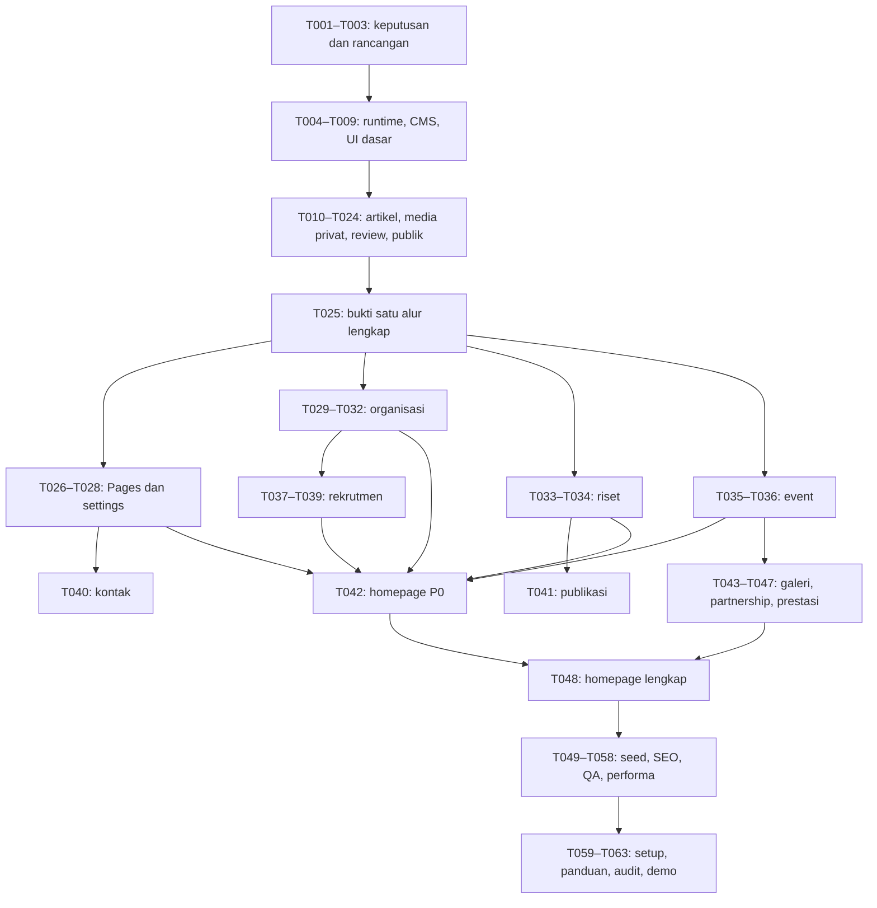

# Rencana Implementasi GIBEI UISI

Tanggal: 21 Oktober 2026. Acuan produk: [PRD v1.1](../docs/PRD-v1.1.md), 20 Oktober 2026.

**Status terbaru — T015 / CP-05:** T001–T015 selesai, CP-04/CP-05 ditinjau. Batch T011–T020 diotorisasi dan sedang berjalan; berikutnya T016. Upload, gateway dan review/publish atomik telah diuji serta aktif di localhost/Supabase. Bukti: [T015](../docs/reports/T015.md). Reader publik, revisi, penarikan dan pencabutan batch ini masih dikerjakan.

## Tujuan dan kondisi awal

Pecah MVP menjadi **63 tugas S/M** dalam enam fase, dengan dependensi, hasil, kriteria selesai, dan verifikasi per tugas. Satu tugas menargetkan satu sesi fokus. Tidak ada estimasi deadline sebelum kapasitas pengembang diketahui.

Pemeriksaan awal menemukan folder docs berisi PRD; belum ada package.json, folder .git, atau tasks/plan.md dan tasks/todo.md. Karena itu struktur kode, nama berkas implementasi, test runner, dan perintah tes di backlog adalah usulan yang harus ditetapkan pada fondasi. Tidak ada backlog lama yang ditimpa.

## Batas rencana

- Seluruh sebelas modul publik serta CMS Admin/Media termasuk MVP; P0/P1 menentukan urutan sesuai baseline PRD yang disetujui.
- Tidak ada visitor account, formulir internal, trading, harga saham real-time, pembayaran, atau deployment produksi.
- D-01–D-10 disetujui pada T001; versi paket diperiksa secara dokumentasi pada T002 dan rancangan teknis selesai pada T003. Integrasi runtime tetap harus dibuktikan pada tugas implementasi.
- Logo, periode/nama pengurus, kontak, tautan daftar, dan mitra boleh memakai placeholder demo berlabel sesuai PRD. Aset yang belum terkonfirmasi tidak diklaim resmi.

## Keputusan arsitektur yang menjadi dasar perencanaan

1. Target stack mengikuti PRD: Next.js App Router/React/TypeScript, Payload, PostgreSQL, Tailwind. Pilihan versi dan pembaruan verifikasi ada pada [stack](../docs/technical/stack.md); T004 membuktikan kerangka/build, T005 membuktikan fondasi PostgreSQL, sedangkan adapter/CMS dan UI penuh mengikuti tugas berikutnya.
2. PostgreSQL memakai Supabase proyek `lgqnxvldjqzgbfyxqonx`; aplikasi tetap localhost. T005 memverifikasi koneksi/migrasi dan T008 mengisolasi target uji. Docker lokal opsional. Buktikan **satu alur artikel lengkap** sebelum memperbanyak collection. T025 menjadi dependensi semua modul editorial tambahan.
3. Versi publik terpisah dari revisi kerja; approval merujuk versi dan aset tertentu. Detail transaksi dan fasilitas CMS dibuktikan pada T003 dan T011–T025, bukan diasumsikan tersedia otomatis.
4. Media privat dan turunannya melewati pemeriksaan izin; referensi publik/konfigurasi menentukan keterlihatan aset. File terbit tidak ditimpa.
5. Aktivasi periode/rekrutmen adalah konfigurasi operasional Admin yang hanya menunjuk konten terbit, terpisah dari review isinya.
6. Tes aturan akses dan kegagalan dibuat pada tugas implementasinya. Fase QA memeriksa cakupan lintas modul dan kondisi nyata, bukan menunda seluruh pengujian ke akhir.

## Peta dependensi utama

Diagram hanya ringkasan alur; **dependensi persis pada setiap tugas di todo.md menjadi acuan eksekusi**, termasuk pekerjaan yang dapat dimulai lebih awal.

## Indeks tugas

Indeks ini tidak menyimpan checklist status kedua; perubahan progress dicatat hanya pada todo.md.

### Fase A — Fondasi proyek

Keputusan, rancangan, runtime lokal, CMS login, dan fondasi UI tersedia.

| Tugas | Hasil ringkas | Dependensi |
|---|---|---|
| [T001](todo.md#t001) | Catat keputusan baseline PRD | — |
| [T002](todo.md#t002) | Verifikasi kompatibilitas stack | — |
| [T003](todo.md#t003) | Rancang kontrak versi dan akses file | T002 |
| [T004](todo.md#t004) | Buat kerangka Next.js dan tooling | T001, T002, T003 |
| [T005](todo.md#t005) | Hubungkan PostgreSQL Supabase dan migration awal | T004 |
| [T006](todo.md#t006) | Aktifkan Payload dan login CMS | T004, T005 |
| [T007](todo.md#t007) | Batasi pengelolaan akun dan sesi | T006 |
| [T008](todo.md#t008) | Siapkan harness uji izin dan browser | T005, T006 |
| [T009](todo.md#t009) | Buat fondasi visual dan layout publik | T004 |

### Fase B — Satu alur artikel lengkap

Draft sampai revisi/penarikan terbukti pada API, CMS, file, dan website publik.

| Tugas | Hasil ringkas | Dependensi |
|---|---|---|
| [T010](todo.md#t010) | Buat draft artikel dengan ownership | T007, T008 |
| [T011](todo.md#t011) | Terima upload privat yang tervalidasi | T008, T010 |
| [T012](todo.md#t012) | Lindungi pembacaan file dan turunannya | T011 |
| [T013](todo.md#t013) | Ajukan dan tarik pengajuan artikel | T010, T011, T012 |
| [T014](todo.md#t014) | Kembalikan artikel untuk revisi | T013 |
| [T015](todo.md#t015) | Terbitkan versi artikel yang disetujui | T013, T014 |
| [T016](todo.md#t016) | Baca hanya versi publik artikel | T015 |
| [T017](todo.md#t017) | Revisi artikel tanpa mengubah versi publik | T015, T016 |
| [T018](todo.md#t018) | Tarik publikasi dan bersihkan cache | T016, T017 |
| [T019](todo.md#t019) | Kelola akses aset yang digunakan ulang | T012, T015, T018 |
| [T020](todo.md#t020) | Amankan hapus dan pencabutan darurat | T019 |
| [T021](todo.md#t021) | Tolak konflik review dan kunci audit | T014, T015, T017, T018 |
| [T022](todo.md#t022) | Tampilkan antrean review dan preview privat | T013, T014, T015, T017, T018, T020, T021 |
| [T023](todo.md#t023) | Buat daftar artikel yang bisa dicari | T009, T016 |
| [T024](todo.md#t024) | Buat detail artikel dan renderer aman | T009, T012, T016, T023 |
| [T025](todo.md#t025) | Buktikan alur artikel lengkap | T007, T008, T019, T020, T021, T022, T023, T024 |

### Fase C — Modul publik P0 lainnya

Pages, organisasi, riset, kegiatan, rekrutmen, kontak, dan homepage P0 terhubung ke workflow yang terbukti.

| Tugas | Hasil ringkas | Dependensi |
|---|---|---|
| [T026](todo.md#t026) | Buat konten Pages dengan review | T025 |
| [T027](todo.md#t027) | Kelola Site Settings oleh Admin | T020, T025, T026 |
| [T028](todo.md#t028) | Tampilkan Tentang dan layout dari CMS | T009, T026, T027 |
| [T029](todo.md#t029) | Kelola periode organisasi melalui review | T025 |
| [T030](todo.md#t030) | Publikasikan delapan profil divisi | T009, T025, T029 |
| [T031](todo.md#t031) | Tampilkan pengurus berdasarkan periode | T009, T029, T030 |
| [T032](todo.md#t032) | Pilih satu periode aktif secara aman | T029, T031 |
| [T033](todo.md#t033) | Kelola riset dengan disclaimer wajib | T025 |
| [T034](todo.md#t034) | Tampilkan daftar dan detail riset | T009, T012, T023, T024, T033 |
| [T035](todo.md#t035) | Kelola event dan aturan waktunya | T025 |
| [T036](todo.md#t036) | Tampilkan daftar dan detail kegiatan | T009, T035 |
| [T037](todo.md#t037) | Kelola kampanye dan posisi rekrutmen | T029, T030, T032, T025 |
| [T038](todo.md#t038) | Batasi aktivasi satu kampanye | T037 |
| [T039](todo.md#t039) | Tampilkan rekrutmen dan CTA tepat waktu | T009, T037, T038 |
| [T040](todo.md#t040) | Tampilkan kontak terkonfirmasi | T027, T028 |
| [T041](todo.md#t041) | Buat pintu masuk publikasi | T023, T024, T034 |
| [T042](todo.md#t042) | Hubungkan homepage dengan modul P0 | T026, T028, T030, T032, T034, T036, T039, T040, T041 |

### Fase D — Modul P1 dan homepage lengkap

Galeri, partnership, prestasi, dan agregasi homepage selesai tanpa mengurangi izin.

| Tugas | Hasil ringkas | Dependensi |
|---|---|---|
| [T043](todo.md#t043) | Kelola album dokumentasi privat | T025, T035 |
| [T044](todo.md#t044) | Tampilkan daftar dan detail galeri | T009, T012, T043 |
| [T045](todo.md#t045) | Kelola mitra dengan izin logo | T025 |
| [T046](todo.md#t046) | Tampilkan partnership publik | T009, T045 |
| [T047](todo.md#t047) | Kelola dan tampilkan prestasi | T009, T025 |
| [T048](todo.md#t048) | Lengkapi homepage dengan modul P1 | T042, T044, T046, T047 |

### Fase E — Seed dan verifikasi menyeluruh

Data demo final, SEO, keamanan, aksesibilitas, dan performa memiliki bukti.

| Tugas | Hasil ringkas | Dependensi |
|---|---|---|
| [T049](todo.md#t049) | Siapkan seed demo lengkap yang aman | T032, T034, T036, T039, T040, T044, T046, T047, T048 |
| [T050](todo.md#t050) | Lengkapi metadata dan canonical | T027, T034, T036, T039, T044, T046, T047, T048, T049 |
| [T051](todo.md#t051) | Buat sitemap, robots, dan structured data | T050 |
| [T052](todo.md#t052) | Lengkapi error handling dan log aman | T025, T027, T048 |
| [T053](todo.md#t053) | Periksa sesi, login, dan input berbahaya | T007, T008, T024, T027, T048 |
| [T054](todo.md#t054) | Uji matriks izin lintas semua collection | T025, T032, T034, T036, T039, T044, T046, T047, T051, T053 |
| [T055](todo.md#t055) | Uji batas waktu dan request bersamaan | T021, T032, T036, T038, T039, T049 |
| [T056](todo.md#t056) | Uji responsivitas dan aksesibilitas | T028, T031, T034, T036, T039, T040, T041, T044, T046, T047, T048, T049 |
| [T057](todo.md#t057) | Ukur performa sesuai kondisi PRD | T049, T050, T051, T056 |
| [T058](todo.md#t058) | Perbaiki hanya hambatan performa terukur | T057 |

### Fase F — Dokumentasi dan demo localhost

Setup dapat diulang, panduan serah terima tersedia, dan MVP dinilai terhadap PRD.

| Tugas | Hasil ringkas | Dependensi |
|---|---|---|
| [T059](todo.md#t059) | Tulis panduan setup dan buktikan clean start | T049, T053, T058 |
| [T060](todo.md#t060) | Tulis prosedur backup dan restore | T049, T059 |
| [T061](todo.md#t061) | Tulis panduan CMS dan naskah demo | T022, T032, T038, T049, T059 |
| [T062](todo.md#t062) | Audit kelulusan MVP terhadap PRD | T051, T052, T054, T055, T056, T058, T059, T060, T061 |
| [T063](todo.md#t063) | Serahkan demo localhost yang dapat diulang | T062 |

## Checkpoint dan cara verifikasi

Ada **23 checkpoint** di todo.md: umumnya setiap tiga tugas, ditambah titik bukti alur artikel dan akhir QA. Checkpoint tidak membuat status tugas otomatis selesai.

- Dokumen/keputusan: tinjau terhadap PRD dan simpan sumber/bukti keputusan; tidak perlu tes aplikasi buatan.
- Perubahan runtime: lint, typecheck, build, tes terarah yang relevan, serta manual browser ketika perilaku UI berubah.
- Akses dan workflow: uji request langsung dengan Admin, owner, assignee, Media lain, dan anonim; UI saja tidak membuktikan otorisasi.
- Penarikan/waktu/file: periksa cache hangat, URL langsung/turunan, batas waktu server, dan request bersamaan.
- Kelulusan akhir: T062 memetakan setiap AC/FR ke tes/laporan aktual. Checkbox tugas tidak menggantikan hasil pengujian.

Nama script yang ditargetkan: T004 menyediakan dev/start/build/lint/typecheck, T008 menyediakan test:unit/test:integration/test:e2e. Cara memberi filter tes mengikuti runner yang nanti dipilih dan didokumentasikan; rencana ini tidak mengklaim perintah tersebut sudah dapat dijalankan.

## Cakupan modul publik

| PRD | Modul | Tugas pelaksana |
|---|---|---|
| FR-01 | Homepage | T009, T026, T042, T048 |
| FR-02 | Tentang | T026, T028 |
| FR-03 | Struktur/divisi | T029, T030, T031 |
| FR-04 | Artikel | T010, T023, T024, T025, T041 |
| FR-05 | Riset | T033, T034, T041 |
| FR-06 | Event | T035, T036 |
| FR-07 | Galeri | T043, T044 |
| FR-08 | Rekrutmen | T037, T039 |
| FR-09 | Partnership | T045, T046, T048 |
| FR-10 | Kontak | T027, T028, T040 |
| FR-11 | Prestasi | T047, T048 |

Seluruh modul juga diperiksa pada T054/T056 dan audit final T062. Tugas yang menambahkan migration, metadata, atau perilaku umum tidak mengganti kebutuhan uji modul itu sendiri.

## Pemetaan 29 acceptance scenario

Tabel menautkan skenario ke tugas yang mengimplementasikan atau menguji perilakunya. T062 mengaudit seluruhnya setelah selesai dan sengaja tidak dipakai sebagai satu-satunya pemilik skenario.

| Acceptance scenario | Tugas pelaksana/penguji |
|---|---|
| AC-01 | T013, T025, T054 |
| AC-02 | T015, T025, T053, T054 |
| AC-03 | T010, T025, T054 |
| AC-04 | T014, T025, T054 |
| AC-05 | T016, T025, T050, T051, T054 |
| AC-06 | T012, T025, T054 |
| AC-07 | T015, T025, T054 |
| AC-08 | T017, T025, T054 |
| AC-09 | T021, T025, T055 |
| AC-10 | T018, T025, T051, T054 |
| AC-11 | T019, T025, T054 |
| AC-12 | T020, T025, T054 |
| AC-13 | T011, T025, T054 |
| AC-14 | T037, T039, T055 |
| AC-15 | T035, T036, T055 |
| AC-16 | T029, T031, T032, T055 |
| AC-17 | T007, T053 |
| AC-18 | T023, T034 |
| AC-19 | T056 |
| AC-20 | T033, T034 |
| AC-21 | T027, T028, T040, T054 |
| AC-22 | T005, T049, T059 |
| AC-23 | T024, T053 |
| AC-24 | T043, T044, T045, T046, T047, T054 |
| AC-25 | T015, T025, T052 |
| AC-26 | T018, T031, T054 |
| AC-27 | T013, T019, T025, T043, T054 |
| AC-28 | T032, T055 |
| AC-29 | T038, T039, T055 |

## Risiko dan tindak lanjut

| Risiko | Dampak | Penanganan dalam backlog |
|---|---|---|
| Perubahan baseline setelah persetujuan | Implementasi menyimpang dari kebutuhan yang disepakati | T001 telah mencatat persetujuan; perubahan berikutnya dicatat eksplisit beserta dampaknya pada PRD/backlog |
| Fitur versi/upload CMS tidak memenuhi aturan | Draft bocor atau approval salah versi | T003 merancang; T011–T025 membuktikan sebelum perluasan |
| Satu tugas membesar setelah melihat kode | Diff sulit ditinjau dan diverifikasi | Pecah menjadi Txxx.1/Txxx.2, pindahkan dependensi dan pemetaan AC; jangan melonggarkan kriteria |
| Media/relasi/cache saling bergantung | Aset bocor atau publikasi rusak setelah penarikan | T018–T021, T054, T055 menguji referensi, konflik, dan kegagalan |
| Materi resmi belum tersedia | Demo disalahartikan sebagai situs resmi | T049 label contoh, T050 metadata contoh, T061 panduan demo |
| Target performa gagal di mesin tertentu | Skor tidak dapat dibandingkan | T057 menyimpan kondisi dan hasil; T058 memperbaiki penyebab terukur |
| Lingkungan produksi belum diputuskan | Demo keliru dianggap siap diluncurkan | T060/T063 memisahkan syarat produksi dan bukti lokal |

## Urutan mulai dan batas serah terima

**T001–T009 selesai; CP-01/CP-02/CP-03 ditinjau. Langkah berikutnya T010:** implementasikan draft artikel dengan ownership dan verifikasi izin dua Media. Fondasi publik belum membuktikan workflow editorial atau kesiapan produksi.

Tidak ada sub-agent, thread baru, issue eksternal, instalasi dependency, atau perubahan aplikasi yang dibuat oleh dokumen rencana ini. Pelaksanaan dapat dilakukan berurutan. Bila kelak dikerjakan beberapa orang, pisahkan modul setelah kontrak T025 stabil; perubahan migration, konfigurasi shared, dan lifecycle media tetap dikoordinasikan.

Persetujuan baseline oleh pemilik proyek dicatat pada T001; validasi konten organisasi dan infrastruktur produksi tetap terbuka. Selesai sampai T063 berarti demo localhost memenuhi PRD dengan bukti, bukan izin menerbitkan website ke internet.

